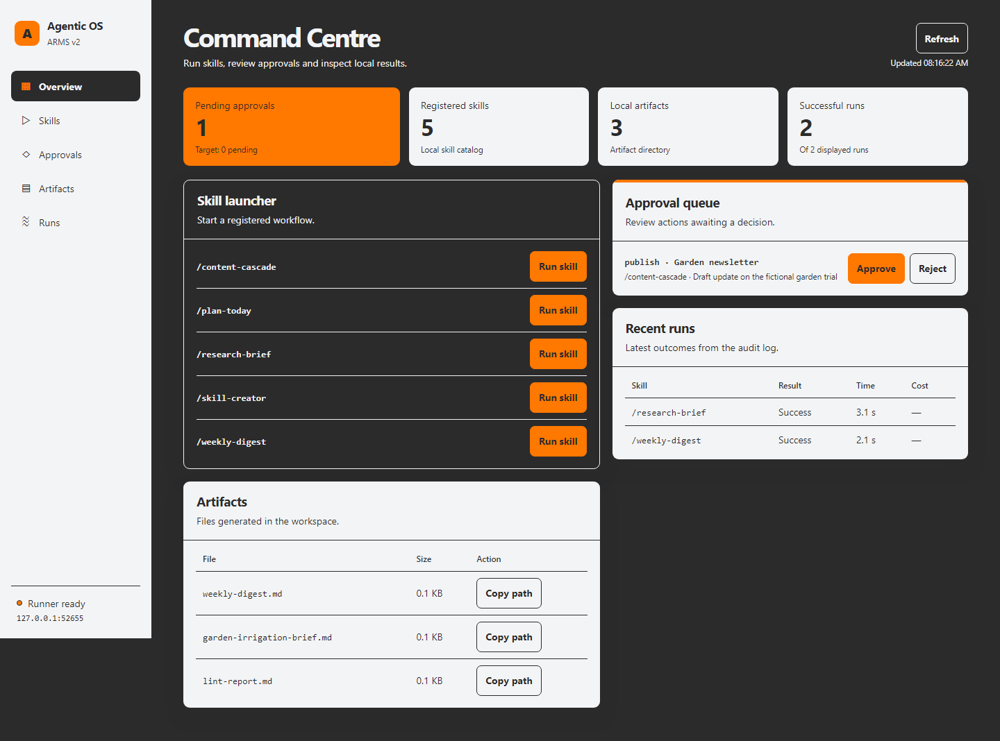
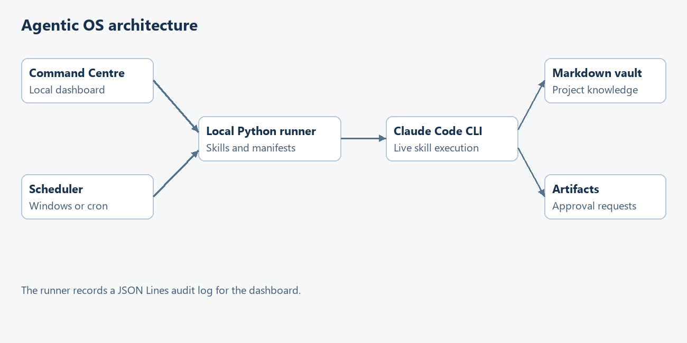

# Agentic OS

Agentic OS is a local workspace for running repeatable AI-assisted tasks, organizing knowledge in Markdown, and reviewing proposed actions.



The running Command Centre displays fictional garden-project approvals, files, and run history. This screenshot was captured from an isolated checkout using the loopback runner.

## Architecture and scope

ARMS stands for **Applications, Routines, Memory, and Skills**. A Python runner serves the single-file Command Centre on the loopback interface. The dashboard lists installed skills and reads artifacts, approvals, and recent runs through the runner. Scheduled routines can invoke the same runner from Windows Task Scheduler or Linux cron. Each skill has a Markdown procedure and a manifest that specifies model, budget, timeout, and the tools available during a run. The four-part model is adapted from [Jay E’s ARMS framework](https://robonuggets.beehiiv.com/p/the-new-agentic-os-format-for-claude-5-models).



The ARMS v2 redesign retired the prototype FastAPI Bridge and plans for Redis, vector services, and streamed responses. Plain files keep local state inspectable and portable, and the reduced service count makes the system easier for one operator to run. Retrieval uses concise Markdown indexes and file search. That suits a curated personal vault and puts more weight on maintaining its indexes as it grows. Headless jobs return a structured result and retain an audit log. Live execution depends on the Claude Code command line and its permission model.

The current scope includes the loopback dashboard, registered local skills, the approval queue, offline Evidence Desk, and scheduling scripts. Approving an item updates its queue record. Sending, spending, and publishing require a separate operator action. The prior Bridge and container configuration are prototype references. Live skill acceptance, per-run cost caps, MCP connectivity, and VPS deployment remain open verification items. See the [architecture decisions](specs/00-OVERVIEW.md) and [runtime handover](HANDOVER.md).

## Try it locally

Use Python 3.10 or later. From the repository root on Windows or Linux:

```powershell
python scripts/init-workspace.py
python apps/runner/server.py serve
```

Open [the Command Centre](http://127.0.0.1:3000). The initializer creates missing private folders and governance files, and the runner creates a gitignored local token. The dashboard and offline examples work without provider credentials. A live **Run skill** action uses an installed, authenticated Claude Code CLI. The runner inherits its shell environment. The root `.env.example` documents settings for the legacy Bridge.

Open [Evidence Desk](apps/research-brief.html) in a local browser, choose **Load fictional demo**, then **Build brief** to preview and download cited Markdown.

| Skill | Local input | Deliverable |
| --- | --- | --- |
| `weekly-digest` | Git history, artifacts, approval queue | Weekly status report |
| `plan-today` | Tasks and an optional local calendar export | Three daily priorities |
| `research-brief` | Source notes in `vault/raw/` | Source-linked wiki note |
| `content-cascade` | Compiled wiki note | Thread outline and newsletter draft |

See [routine operations](docs/routines.md) for Task Scheduler registration, sign-in requirements, and cron setup.

## Security and verification

The runner binds to `127.0.0.1`, uses a bearer token for protected API routes, validates browser origins, and accepts only registered skill names. It invokes the agent without a shell and uses manifest-scoped tools for headless runs. A workspace lock prevents concurrent skill runs. The approval queue records proposed external actions for human review.

Run the provider-free checks from the repository root after initialization:

```powershell
python scripts/lint-routers.py
python tests/test_runner_security.py
python tests/test_workspace_init.py
python tests/test_runner_execution.py
python tests/test_routines.py
python tests/evaluate_skill_catalog.py
```

The HTTP security check starts its own runner on port 3000. Stop the dashboard runner before doing that check. The [Evidence Desk browser suite](tests/test_micro_app.py) also runs offline with Playwright and Chromium installed.

Codex ran the four skill fixtures directly in isolated synthetic workspaces. The fixtures check the outputs against expected content and integrity rules. Live runner behavior and provider cost controls are still pending. See the [verification record](TODO.md) and [connector audit](docs/mcp-connectors.md).

## My role

I defined the project as a single-operator workspace that stores knowledge and artifacts locally and keeps external actions under human review. I chose the loopback runner and plain-file design to replace the middleware-heavy prototype and scoped the work to text-based workflows. I used the security, initialization, routine, and browser checks to review the implementation and Codex fixture runs to check four skill workflows with synthetic inputs. I deferred VPS deployment and live provider acceptance until the necessary environment and access could be verified. See the [builder brief](PROMPT-FOR-BUILDER.md), [architecture decision record](specs/00-OVERVIEW.md), and [handover](HANDOVER.md).

## Project files

- [Active specifications](specs/00-OVERVIEW.md) outline the design and link to the runner, skills, memory, and dashboard specs.
- [System index](memory/SYSTEM.md) links to implementation files, maintenance scripts, and review procedures.
- [Example vault](example-vault/wiki/index.md) contains fictional notes. The initialized private vault and generated output are gitignored.
- [MIT License](LICENSE).
