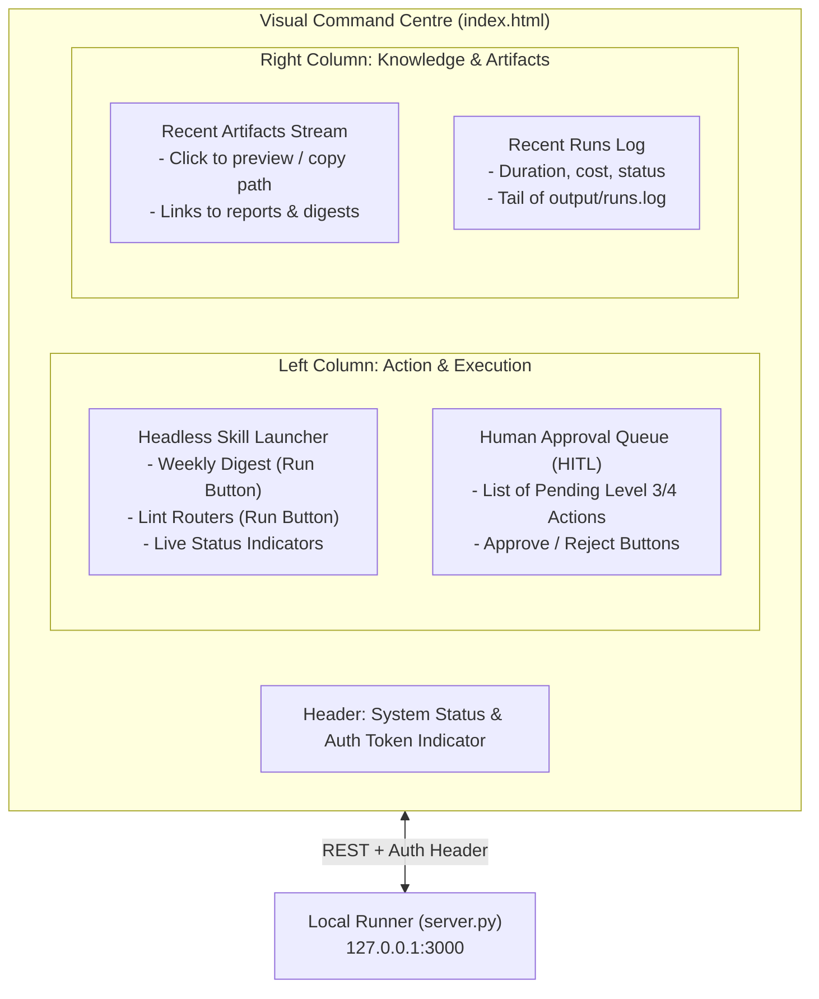

# AGENTIC OS — VISUAL COMMAND CENTRE SPECIFICATION

## 1. Principles & Purpose

The **Visual Command Centre** is the front door of Agentic OS—a single-page, zero-dependency HTML dashboard served locally at a fixed address.
1. **One Page, One Address:** Always available at `http://127.0.0.1:3000`.
2. **Show, Do Not Store:** The dashboard is a transparent lens reading filesystem artifacts, logs, and queue records. It maintains no independent database.
3. **Every Widget Earns Its Place:** Glanceable numbers, recent deliverables, one-click headless triggers, and human approvals.
4. **Zero Framework Build Steps:** Written in plain, self-contained HTML/CSS/JS with no npm build or compilation steps.

---

## Dashboard Design Brief

The Command Centre is an operational view for the local workspace operator. Its
first decision is whether pending actions need review, with a target of zero
pending. Runner status, artifact count, skill count, and successes among the
latest eight displayed audit entries use the existing local API. The page
refreshes on open, every six seconds, and on demand. Partial failures identify
the affected panels and leave unavailable counts blank.

The saved **Charcoal + Lime + Soft Gray** example informs the palette structure,
with bright orange as the requested accent.
Charcoal gray (#2b2b2b) anchors the canvas, soft gray
(#f3f4f6) defines the navigation and raised detail panels, and bright orange
(#ff7800) marks primary actions and pending approvals. These three solid
swatches carry the 60/30/10 visual roles. The Dark Mode Elevation reference
informs spacing, surface contrast and shadows. The layout stacks on narrow
screens and tables scroll within their panels when needed. Start the local preview with
`python apps/runner/server.py serve` and open `http://127.0.0.1:3000`.

## 2. Interface Components

### 2.1 The Four Core Widgets
1. **Artifacts Stream:** Reads the directory listing of `output/artifacts/`, showing the newest generated summaries, reports, and outlines with instant preview modals and copy-path buttons.
2. **Headless Skill Launcher:** Clean trigger tiles for registered skills (e.g. `weekly-digest`, `lint-routers`). Clicking a button dispatches an authenticated POST to `/api/v1/run-skill` with real-time state transitions (`idle` → `running` → `success` / `error`).
3. **Approval Queue Reviewer (HITL):** Polls `/api/v1/approval-queue` to display pending destructive requests. Renders the action type, skill name, payload path, and **Approve** / **Reject** buttons.
4. **System Health & Run Audit:** Displays last run time, recent execution duration, cost, and overall system status parsed from `output/runs.log`.

---

## 3. Server Integration (`apps/runner/server.py`)

The Command Centre is served directly by the Python local runner:
* `GET /`: Serves `apps/command-centre/index.html`.
* `GET /api/v1/status`: Health check, uptime, and system metadata.
* `GET /api/v1/artifacts`: Lists files in `output/artifacts/`.
* `GET /api/v1/runs`: Returns the last 10 entries from `output/runs.log`.
* `GET /api/v1/approval-queue`: Returns pending items from `output/approval_queue.jsonl`.
* `POST /api/v1/run-skill`: Triggers headless execution of an allowlisted skill.
* `POST /api/v1/approval-queue/{id}/approve`: Approves a pending HITL request.
* `POST /api/v1/approval-queue/{id}/reject`: Rejects a pending HITL request.

---

## 4. Acceptance Criteria

- [ ] Command Centre loads in any modern web browser without internet access or CDN dependencies.
- [ ] Served strictly from `127.0.0.1:3000` by the hardened local runner.
- [ ] Displays live artifact list from `output/artifacts/`.
- [ ] Allows one-click headless skill execution for allowlisted skills.
- [ ] Renders pending approval requests with functional Approve and Reject actions.
