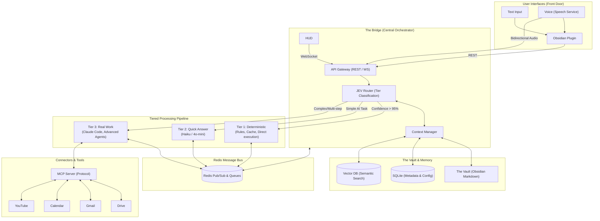
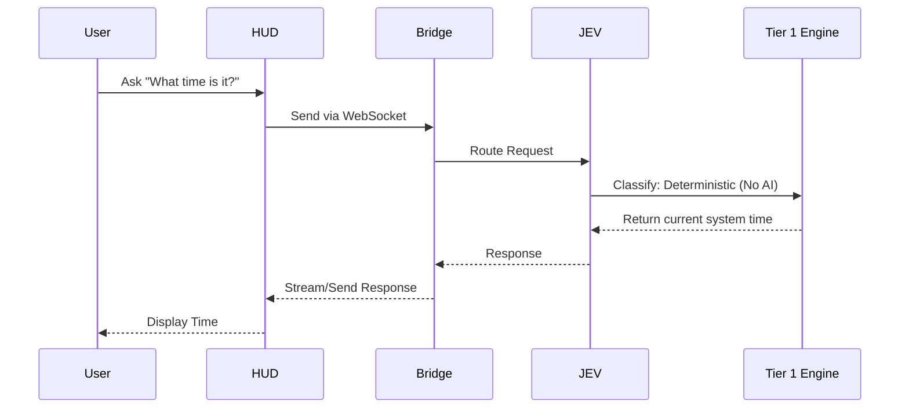
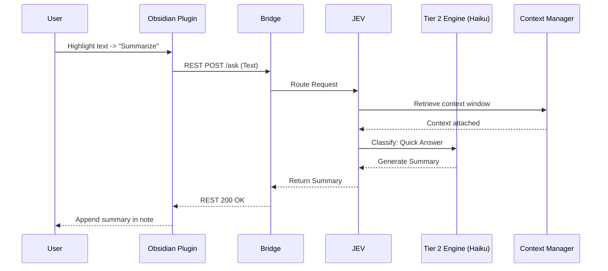
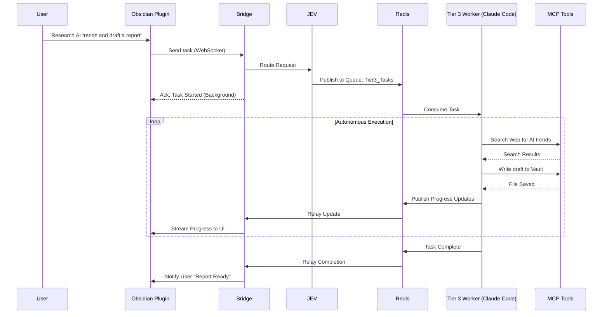
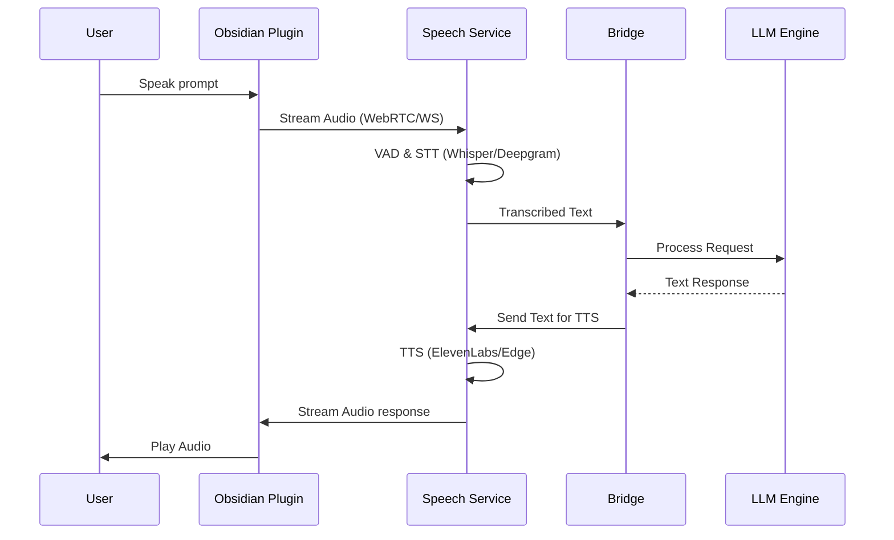

# AGENTIC OS — SYSTEM ARCHITECTURE

## 1. Architectural Philosophy

Agentic OS is built on the foundation of Andrej Karpathy's LLM OS analogy, treating the Large Language Model not just as a chatbot, but as the central processing unit of a broader computing ecosystem. 

- **LLM = CPU:** The core reasoning engine capable of processing instructions, routing tasks, and generating outputs.
- **Context = RAM:** The immediate memory (short-term state, active documents, conversation history) fed into the LLM's context window.
- **Vault (Obsidian) = Disk:** The persistent, long-term storage of all knowledge, memories, logs, and configurations.
- **Tools/Connectors = Peripherals:** External capabilities (web browsing, API access, code execution) that the OS can interact with.

### Key Design Principles

1. **Multi-frontend, Single-brain Design (The Bridge Pattern):** The core intelligence (The Bridge) is decoupled from the user interfaces. Whether interacting via the Obsidian Plugin or Voice, the same central orchestrator handles the processing, ensuring consistency in state and memory.
2. **Tiered Processing with Confidence-Gated Cascade Routing:** Not every request requires a massive LLM. The JEV Router routes tasks based on complexity:
   - **Tier 1:** Deterministic / No AI (Direct tool execution, cached queries)
   - **Tier 2:** Quick Answer (Fast, small models like Claude 3 Haiku or GPT-4o-mini)
   - **Tier 3:** Real Work (Heavy reasoning, multi-step execution using Claude Code or advanced agents)
3. **Event-Driven, Message-Based Communication:** Components operate asynchronously using a Redis message bus, allowing decoupled execution, real-time streaming, and robust handling of background tasks.

## 2. System Architecture Diagram

## 3. Component Communication

Agentic OS relies on robust, asynchronous, and heterogeneous communication protocols tailored to the needs of each component.

- **WebSocket:** Used for real-time, low-latency communication between the Obsidian Plugin and The Bridge. Enables token-by-token streaming of LLM responses and real-time status updates for Tier 3 background tasks.
- **REST API:** Used by the Obsidian Plugin for synchronous operations like triggering a summary of the current note or fetching configuration.
- **Redis Pub/Sub & Queues:** Forms the backbone of internal microservice communication. The Bridge publishes tasks to specific tier queues. Worker nodes process these and publish results back.
- **Model Context Protocol (MCP):** Standardized protocol for providing context (The Vault) and tools (Connectors) to the LLM engines, ensuring secure and extensible tool execution.

### Sequence Diagrams

#### a. Tier 1 Path: Deterministic Query (e.g., "What time is it?" or Cache Hit)

#### b. Tier 2 Path: Quick Answer (e.g., "Summarize this paragraph")

#### c. Tier 3 Path: Complex Research / Real Work

#### d. Voice Interaction Flow

## 4. Data Flow Architecture

### Request Lifecycle
1. **Ingestion:** User action is captured by a frontend (Obsidian or Voice). The frontend packages the input and current local context (e.g., currently active window or selected text).
2. **Orchestration:** The request hits the API Gateway of The Bridge.
3. **Context Assembly:** The Context Manager intercepts the request. It queries the Vector DB for semantically relevant past memories and retrieves the user's base configuration/system prompt from SQLite.
4. **Routing:** The JEV Router evaluates the enriched request. Based on regex matching, confidence scoring, and intent classification, it forwards the request to Tier 1, 2, or 3.
5. **Execution:** The selected Tier processes the request. Tier 3 may recursively call Tools via MCP.
6. **Response & Persistence:** The output is routed back to The Bridge. Before sending it to the frontend, The Bridge asynchronous saves the interaction log and any newly generated knowledge into the Vault (and embeds it into the Vector DB).
7. **Delivery:** The response is streamed or delivered to the original frontend.

## 5. Deployment Architecture

The entire ecosystem is designed with a **Local-first** philosophy. The user owns their data, and core orchestration runs on the user's hardware.

- **Infrastructure as Code:** Deployed via `docker-compose`.
- **Environment:** Windows Subsystem for Linux (WSL2) or native Docker Desktop on Windows.

### Docker Compose Service Topology

| Service | Port | Description |
|---|---|---|
| **The Bridge** | `8000` | FastAPI / Node.js backend. Core orchestrator. |
| **Speech Service** | `8080` | Python service handling STT and TTS. |
| **Redis** | `6379` | Message broker for inter-process communication. |
| **SQLite / VectorDB**| `8001` | ChromaDB/Qdrant or local SQLite extensions. |
| **MCP Server** | `9000` | Tool server interfacing with external APIs. |

### Volume Mounts
To ensure persistence and allow The Vault to act as the "Disk":
- `vault_data:/app/vault` -> Mapped to the user's actual local Obsidian Vault directory (e.g., `C:/Users/your-user\Documents\Vault`).
- `db_data:/app/db` -> Persists SQLite and Vector DB indices.
- `config_data:/app/config` -> Local configuration files and environment variables.

## 6. Scalability & Extensibility

Agentic OS is designed to be highly modular, ensuring it can grow with future AI advancements.

### Plugin Architecture (Connectors)
The MCP (Model Context Protocol) integration allows seamless addition of new Connectors. If a new service (e.g., Notion, GitHub) needs integration, a new MCP tool is defined and registered with The Bridge. The LLM automatically discovers these tools via the MCP protocol without requiring core code changes.

### Skill System
For specialized tasks (e.g., "Analyze stock portfolio", "Edit video"), developers can drop Python scripts or specialized sub-agents into a `skills/` directory. The JEV Router indexes these skills at startup and adds them to Tier 1 or Tier 3 routing logic as distinct capabilities.

### Model-Agnostic Design
The OS relies on abstract interfaces for LLM interactions (e.g., using litellm or LangChain wrappers). Switching from OpenAI (`gpt-4o`) to Anthropic (`claude-3-5-sonnet`) or a local model (`llama-3` via Ollama) is a simple configuration change in the UI or `.env` file. The prompt formatting and tool binding are handled dynamically by the adapter layer.
