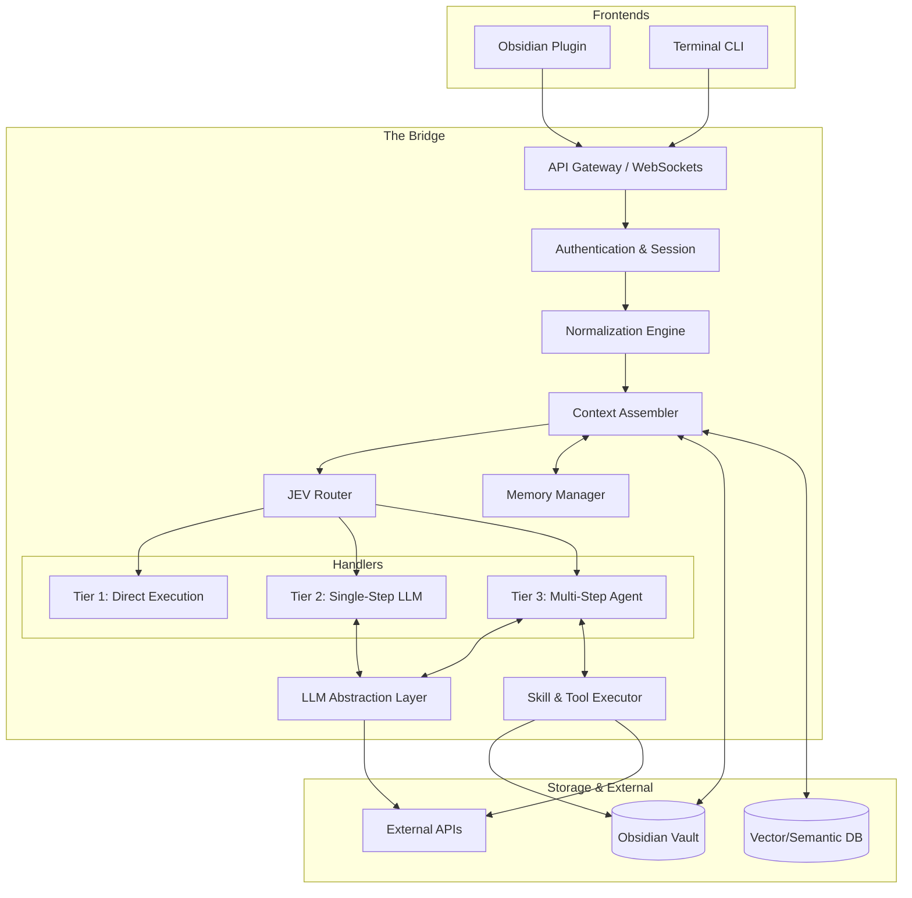
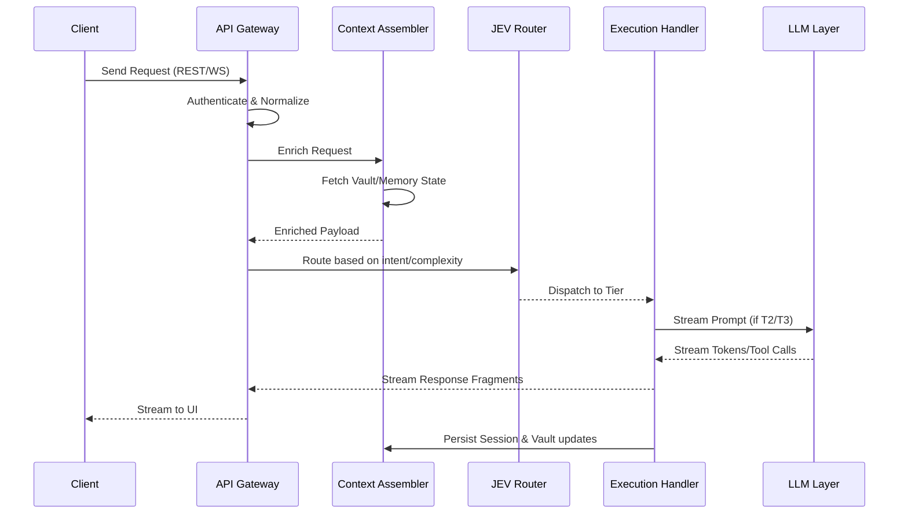

# AGENTIC OS — THE BRIDGE SPECIFICATION

## 1. Purpose & Role

The Bridge is the central orchestration engine of Agentic OS, acting as the single unified backend—"one brain for both apps." It processes every incoming request from all front doors (Obsidian Plugin, Jarvis HUD), orchestrates routing through the Just Enough Validation (JEV) system, executes tools and skills, and streams responses back.

**Core Responsibilities:**
- **Unified Backend:** A single point of entry for all client requests.
- **Pipeline Processing:** Handles the full lifecycle of a request from ingestion to fulfillment.
- **Context Assembly:** Aggregates context from the Vault, semantic memory, and session history before interacting with LLMs.
- **LLM Orchestration:** Provides an abstraction layer over LLMs (Claude, OpenAI, Local models) with full support for streaming and tool calling.
- **State & Session Management:** Manages conversational state, context windows, and cross-session persistence.
- **Skill Execution:** Coordinates the dispatch and execution of external tools, scripts, and internal system actions.

## 2. Architecture

### Internal Components


### Request Processing Pipeline


## 3. Technology Choice

The Bridge is built using **FastAPI (Python)**.

**Why FastAPI?**
- **Async/Await Native:** Crucial for handling concurrent streaming requests and non-blocking I/O operations (file reading, network requests).
- **Streaming & WebSockets:** First-class support for Server-Sent Events (SSE) and WebSockets, which are mandatory for real-time LLM token streaming and HUD voice features.
- **Pydantic Validation:** Strict schema validation ensures robust data pipelines from frontend to LLM to storage.
- **Ecosystem:** Python has the most mature ecosystem for AI, LLMs (LangChain, LlamaIndex, official SDKs), and data processing.

*Alternative Considerations:* Node.js/Bun with Hono or Express could be used if strict TypeScript unification is preferred, but Python remains superior for rapid AI integration and script execution.

## 4. Request Processing Pipeline

Every incoming request goes through the following stages:

1. **Receive:** The Gateway accepts requests via REST (for simple actions) or WebSocket (for streaming chat/voice).
2. **Authenticate:** Validates the API key or session token. Rejects unauthorized access.
3. **Normalize:** Converts frontend-specific payloads (e.g., an Obsidian markdown block vs. a Jarvis voice transcript) into a unified internal `StandardRequest` object.
4. **Enrich:** Pulls user context, active file content (if in Obsidian), recent conversational history, and relevant semantic memory snippets.
5. **Route:** The JEV (Just Enough Validation) module evaluates the request's complexity and assigns it to a Tier (T1, T2, T3).
6. **Execute:** The request is dispatched to the corresponding Tier handler. T3 may involve looping through the Tool/Skill Executor.
7. **Stream:** Tokens and intermediate tool execution states are streamed back to the requesting frontend immediately to minimize perceived latency.
8. **Persist:** Upon completion, the conversation is saved, the semantic memory is updated, and an optional "receipt" is generated in the Vault for auditability.

## 5. API Endpoints

### Core REST & WebSocket API

| Endpoint | Method | Description |
|---|---|---|
| `/api/v1/chat` | `POST` | Send a standard text message. Supports SSE for streaming replies. |
| `/api/v1/stream` | `WS` | WebSocket connection for persistent duplex streaming (ideal for Jarvis HUD). |
| `/api/v1/voice` | `POST` | Accepts an audio blob (multipart/form-data), returns transcribed text and intent. |
| `/api/v1/context` | `GET` | Retrieve the current system context, active session details, and vault state. |
| `/api/v1/skill/{name}`| `POST` | Directly execute a specific skill by name bypassing LLM routing (Tier 1). |
| `/api/v1/status` | `GET` | Health check endpoint (system load, external API status). |
| `/api/v1/ingest` | `POST` | Trigger background processing/ingestion of new Vault contents. |
| `/api/v1/memory` | `GET` | Query semantic memory and past conversation snippets. |

*Data Structures Example:*
```python
class ChatRequest(BaseModel):
    message: str
    session_id: Optional[str]
    client_source: Literal["obsidian", "cli"]
    context_overrides: Optional[dict]
```

## 6. LLM Integration Layer

The Bridge abstracts the underlying LLM provider to ensure future-proofing.

- **Model Abstraction:** A unified interface implementing `generate()`, `stream()`, and `execute_tools()`. Easily swap between Anthropic Claude (primary for coding), OpenAI GPT-4, or local models via Ollama.
- **Context Window Management:** Monitors token counts using tiktoken or model-specific tokenizers. Automatically summarizes older messages when approaching limits.
- **Streaming Response Handling:** Yields standard chunks (e.g., `{"type": "text", "content": "..."}`) regardless of the underlying provider's format.
- **Tool/Function Calling Protocol:** Maps internal Python functions (Skills) to OpenAI/Anthropic tool schemas dynamically.
- **Configuration & Cost Tracking:** Tracks `prompt_tokens` and `completion_tokens` per request. Calculates estimated cost and logs it per session.

## 7. Session Management

- **Conversation Threading:** Every interaction belongs to a `SessionID`. Sessions timeout after inactivity but can be resumed.
- **Context Window Sliding:** Implements a sliding window. Once a session exceeds `MAX_TOKENS * 0.8`, the memory manager generates a rolling summary of the oldest messages and drops the raw text.
- **User Identity:** While currently single-user, the architecture supports user profiles for preferences (e.g., preferred response verbosity, primary model choice).
- **Cross-Session Memory Persistence:** Extracts key facts from sessions and stores them in the Vector DB for long-term recall.

## 8. Configuration

Managed via a `.env` file and a structured YAML config.

- **Environment Variables:** `ANTHROPIC_API_KEY`, `OPENAI_API_KEY`, `VAULT_PATH`, `DB_PATH`, `PORT`, `HOST`.
- **Config File (`config.yaml`):**
  ```yaml
  system:
    port: 8000
    log_level: INFO
  models:
    primary: claude-3-5-sonnet-20240620
    fallback: gpt-4o-mini
    embedding: text-embedding-3-small
  memory:
    max_context_tokens: 16000
  ```
- **Model Switching:** Can be toggled on-the-fly via the API or config reload without restarting the server.

## 9. Error Handling & Resilience

- **Graceful Degradation:** If the primary LLM API is down, automatically fail over to the `fallback` model. If all external APIs fail, degrade to local models or return cached/static responses.
- **Retry Logic:** Implements exponential backoff (e.g., using `tenacity` in Python) for rate limits (HTTP 429) and transient network errors.
- **Rate Limiting:** Protects endpoints from spam or infinite loops caused by malfunctioning autonomous agents. Limit per IP/Client Source.
- **Tool Failure Handling:** If a skill execution fails, the error is fed back to the LLM (in T3) to allow the agent to self-correct and try an alternative approach.

## 10. Logging & Observability

- **Structured Logging:** All logs are output in JSON format including trace IDs, session IDs, and execution times.
- **Token Usage Tracking:** Logged per request and aggregated for cost analysis.
- **Performance Metrics:** Measures latency at each pipeline stage (Receive -> JEV -> Exec -> First Token -> Complete).
- **Audit Trail:** Significant actions (e.g., modifying Vault files, executing shell commands) generate a markdown receipt saved in `Vault/receipts/{date}-{action}.md` for user visibility and rollback capability.
