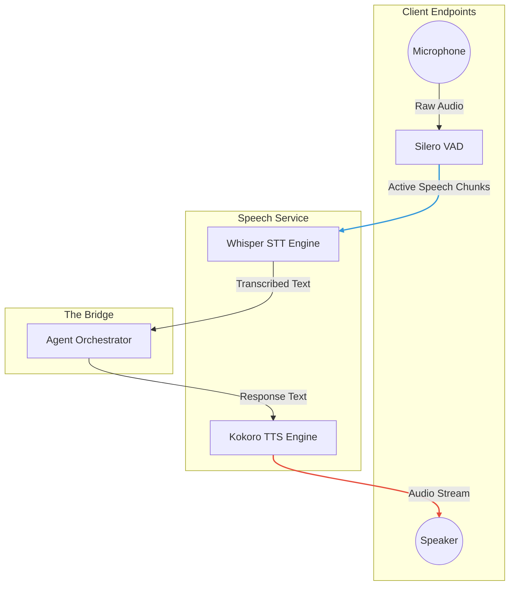

# AGENTIC OS — SPEECH SERVICE SPECIFICATION

The Speech Service provides ears (Whisper STT) and voice (Kokoro TTS) for the Agentic OS. It runs as a standalone microservice that The Bridge calls for audio processing.

## 1. Purpose
- **Whisper = Ears**: Speech-to-Text (STT) capabilities.
- **Kokoro = Voice**: Text-to-Speech (TTS) capabilities.
- Enables voice-first interaction from the Obsidian Plugin.
- Runs locally for maximum privacy and zero recurring API costs.

## 2. Architecture


*Note: Audio streaming utilizes WebRTC or WebSockets for real-time bidirectionality.*

## 3. Speech-to-Text (STT) Pipeline

### 3.1 Voice Activity Detection (VAD)
- **Engine**: Silero VAD for highly accurate speech boundary detection.
- **Location**: Runs client-side in browser (Web Worker) or server-side before STT.
- **Benefits**: Prevents sending background noise or silence to Whisper, drastically reducing processing load.
- **Configuration**:
  - `threshold`: Confidence threshold (e.g., 0.5)
  - `min_speech_duration_ms`: Minimum length to consider as speech (e.g., 250ms)
  - `min_silence_duration_ms`: Silence duration to consider speech ended (e.g., 1000ms)

### 3.2 Whisper Engine Options

| Engine | Use Case | Performance Profile | Requirements |
|---|---|---|---|
| **faster-whisper (CTranslate2)** | Primary local choice | ~4x faster than base Whisper, lower memory | 2GB+ VRAM (GPU) or decent CPU |
| **whisper.cpp** | Apple/CPU optimized | Highly optimized for Apple Silicon Metal / CPU | CPU, Mac |
| **Groq Whisper API** | Cloud fallback | Ultra-low latency (<100ms) | Groq API Key |
| **OpenAI Whisper API** | Cloud fallback | Standard cloud transcription | OpenAI API Key |

### 3.3 STT API

#### REST Endpoint: `POST /api/v1/stt`
Transcribe an audio file.

**Request:** `multipart/form-data`
- `file`: Audio file blob (WAV, WebM, OGG). 16kHz sample rate preferred.
- `language`: (Optional) ISO code.
- `response_format`: (Optional) `json`, `text`, `srt`, `verbose_json`.

**Response:**
```json
{
  "text": "The transcribed text.",
  "language": "en",
  "confidence": 0.98,
  "segments": [
    {
      "id": 0,
      "start": 0.0,
      "end": 2.5,
      "text": "The transcribed text."
    }
  ]
}
```

#### WebSocket Endpoint: `WS /api/v1/stt/stream`
Real-time streaming transcription.
- Client streams binary audio frames.
- Server returns JSON messages with partial and final transcripts.

## 4. Text-to-Speech (TTS) Pipeline

### 4.1 Kokoro-82M (Primary Local)
- **Model**: 82M parameter model, Apache 2.0 license.
- **Quality**: Studio-grade 24kHz audio output.
- **Performance**: Faster than real-time generation on consumer CPUs.
- **Deployment**: Shipped via a Kokoro-FastAPI Docker container that exposes an OpenAI-compatible `/v1/audio/speech` endpoint.
- **Features**: Configurable voice selection, speed, and emotion.

### 4.2 ElevenLabs (Premium Cloud)
- **Use Case**: For ultra-expressive, cinematic voice quality.
- **Features**: Custom voice cloning capability, precise prosody.
- **Protocol**: WebSocket streaming for low-latency generation.
- **Cost**: Pay-per-character (external service).

### 4.3 TTS API

#### REST Endpoint: `POST /api/v1/tts`
Generate speech from text.

**Request:** `application/json`
```json
{
  "text": "Hello, I am the Agentic OS.",
  "voice_id": "alloy",
  "speed": 1.0,
  "pitch": 1.0,
  "response_format": "wav"
}
```
**Response:** Binary audio stream (WAV, MP3, OGG).

#### WebSocket Endpoint: `WS /api/v1/tts/stream`
Stream speech as text arrives (ideal for LLM text streaming).
- Client sends text chunks.
- Server streams back generated audio chunks immediately.

## 5. Audio Streaming Architecture

- **WebRTC (via LiveKit)**: The primary mechanism for bidirectional, ultra-low-latency audio. Handles network fluctuations seamlessly.
- **WebSocket Fallback**: Used when WebRTC is unfeasible or blocked.
- **Client-Side**: Browser `AudioContext` integration for capturing microphone input and playing audio streams.
- **DSP**: Built-in Echo Cancellation (AEC), Noise Suppression, and Auto Gain Control (AGC) implemented at the client level before hitting the server.

## 6. Deployment

- **Containerization**: Packaged as a standalone Docker container (`agentic-os-speech`).
- **Hardware Acceleration**:
  - GPU support via NVIDIA CUDA for faster-whisper.
  - CPU-only mode utilizing heavily optimized inference engines (whisper.cpp) for hardware without dedicated GPUs.
- **Model Management**: Automatic downloading and local caching of required models (Whisper weights, Kokoro-82M weights) on first boot.
- **Networking**: Configurable port mapping (defaulting to `8002` for Speech Service).

## 7. Performance Requirements

- **STT Latency**: `<500ms` for a 5-second utterance on local GPU.
- **TTS Time-to-First-Audio (TTFA)**: `<200ms` for Kokoro local.
- **Supported Languages**: English (Primary), Multilingual capabilities via Whisper large-v2 or large-v3-turbo.

## 8. Integration with The Bridge

- **Orchestration**: The Bridge maintains a connection pool to the Speech Service.
- **Data Flow**:
  1. The Bridge receives an audio stream from the frontend (Obsidian or Voice).
  2. The Bridge proxies the stream to the Speech Service `WS /api/v1/stt/stream`.
  3. Final transcript is passed to the Agent workflow.
  4. Agent text response is streamed to The Bridge.
  5. The Bridge forwards text chunks to the Speech Service `WS /api/v1/tts/stream`.
  6. Generated audio is streamed directly back to the frontend.
- **Resilience**: The Bridge implements automatic fallback (e.g., from local Whisper to Groq API if local processing fails or is overloaded).
- **Format Conversion**: The Bridge handles minor format transcoding if necessary, though 16kHz PCM or OPUS is preferred end-to-end to minimize overhead.
