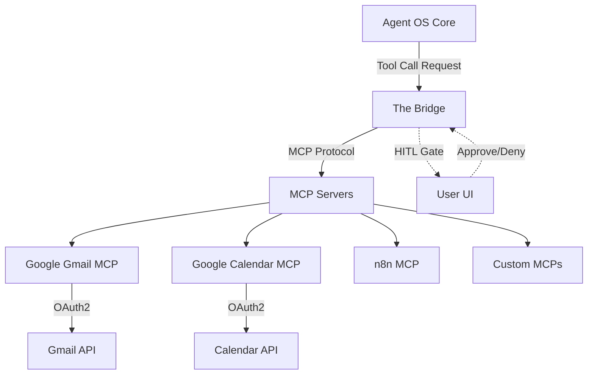

# AGENTIC OS — CONNECTORS SPECIFICATION

Connectors are the integration layer that connects the Agentic OS to external services. They provide standardized interfaces for Gmail, Calendar, Drive, YouTube, and other services.

## 1. Connector Architecture

The Agentic OS leverages a Model Context Protocol (MCP) first approach to securely and consistently access external services.

- **MCP-First Approach**: All tool access and integration capabilities are provided via Model Context Protocol servers. This abstracts the underlying API complexities and provides a standardized schema for tools.
- **Authentication**: OAuth2 is the primary authentication mechanism, specifically tailored for Google Services and other providers supporting modern delegated authorization.
- **Human-in-the-Loop (HITL)**: All destructive, outgoing, or state-mutating actions (write, send, delete, update) require explicit human confirmation.
- **Resilience**: Implements strict rate limiting and exponential backoff strategies to handle API quotas and transient failures gracefully.
- **Credential Management**: Secure, local storage of API keys and OAuth tokens using encrypted databases, ensuring no credentials leak into the LLM context unnecessarily.

## 2. Google Workspace Connectors

Each connector operates under the principle of least privilege, requiring only the scopes necessary for its defined tasks. Operations are classified into Read and Write, with strict HITL gates applied to Write operations.

### 2.1 Gmail Connector
- **Read Operations**: List messages, perform advanced search queries, retrieve message threads, download attachments.
- **Write Operations**: Create drafts, mark as read, trash messages.
  - *HITL Gate*: Explicit user review and confirmation required before a draft can be sent.
- **Scopes**: `gmail.readonly`, `gmail.compose`
- **MCP Server**: `google-gmail-mcp`

### 2.2 Google Calendar Connector
- **Read Operations**: List upcoming events, retrieve detailed event information, check free/busy availability.
- **Write Operations**: Create new events, update existing events, respond to invitations.
  - *HITL Gate*: User confirmation required for all event creations and updates.
- **Scopes**: `calendar.events.readonly`, `calendar.events`
- **MCP Server**: `google-calendar-mcp`

### 2.3 Google Drive Connector
- **Read Operations**: List files in directories, retrieve file content (text/doc extraction), perform file search.
- **Write Operations**: Create new files, update file content.
  - *HITL Gate*: User confirmation required specifically for overwriting existing file content.
- **Scopes**: `drive.readonly`, `drive.file`
- **MCP Server**: `google-drive-mcp`

### 2.4 YouTube Connector
- **Read Operations**: List channel videos, retrieve video analytics, search and read comments.
- **Write Operations**: Update video metadata (title, description, tags), upload new videos.
  - *HITL Gate*: User confirmation required for all metadata updates and video uploads.
- **Scopes**: `youtube.readonly`, `youtube.upload`
- **MCP Server**: `google-youtube-mcp` (custom)

## 3. Social Media Connectors

- **X/Twitter**:
  - Read: Fetch user timeline, mentions, search hashtags.
  - Write: Post tweets, reply to threads. (*HITL Gate: Required for all posts*)
- **LinkedIn**:
  - Read: Read user feed, fetch profile data.
  - Write: Post updates, publish articles. (*HITL Gate: Required for all posts*)
- **GitHub**:
  - Read: Read repositories, fetch issues and PRs, review code.
  - Write: Create issues, open Pull Requests, add comments. (*HITL Gate: Required for creating PRs and merging*)
- **Discord**:
  - Read: Read channel messages, fetch member lists.
  - Write: Send messages to designated channels. (*HITL Gate: Configurable per channel, default off for bot channels*)

## 4. Automation Connector (n8n)

Integrates deeply with n8n to offload complex, multi-step deterministic workflows.

- **Webhook Triggers**: Agentic OS can trigger predefined n8n workflows via authenticated webhooks.
- **Workflow Execution**: Pass structured JSON payloads to n8n to execute external automations.
- **Status Monitoring**: Poll or receive callbacks for long-running n8n executions.
- **Integration with Skill Engine**: Skills can be defined as wrappers around specific n8n workflows, exposing them as tools to the LLM.

## 5. Adding Custom Connectors

Extending the Agentic OS with new connectors follows a standardized lifecycle:

1. **MCP Server Template**: Bootstrap a new connector using the provided Node.js/Python MCP server templates.
2. **OAuth Flow Setup**: Define required scopes and register the client application in the provider's developer console.
3. **Tool Registration**: Expose the connector's capabilities as JSON Schema tools via the MCP protocol to *The Bridge*.
4. **Testing and Validation**: Utilize the internal mock framework to simulate API responses and validate HITL triggers before deployment.

## 6. Security & Credential Management

- **Token Storage**: OAuth tokens and API keys are stored in an encrypted local SQLite database (using AES-256-GCM). The decryption key is derived from the user's OS login or a master passphrase.
- **Token Refresh**: Automated background daemon handles OAuth2 token refresh cycles before expiration.
- **Scope Management**: Connectors strictly request only the scopes defined in their configuration. Scope escalations require re-authorization.
- **Audit Logging**: Every external API call made by a connector is logged locally, detailing the timestamp, tool used, parameters, and the user approval receipt (if HITL was invoked).
